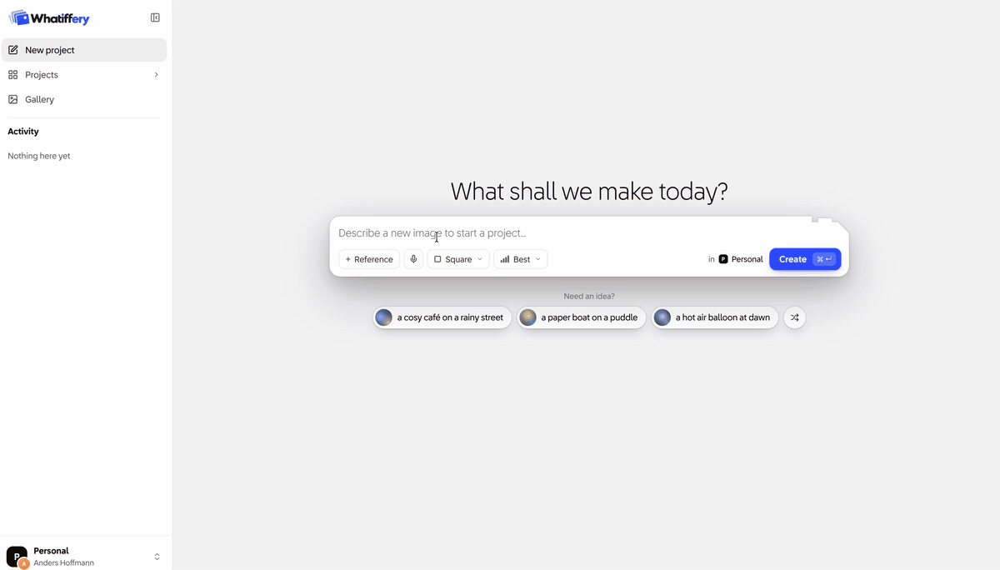

<h1 align="center">Whatiffery</h1>

  Design of AI Image generator with refinement loop at it's core

  

  <a href="design/"><b>See Full Design</b></a>

## Scope 

For my case solution, I have focused on experience design, and not the technical design or implementation. The UX is for me the most interesting aspect of the case, and with a time limit of 4 hours I decided it was the best use of my time. 

## My Process

For transparency, here are the steps I went through to get to the result: 

- Read the case, then took a walk to think about how I wanted to approach it.  
- Took all the thoughts and ideas I had, along with visual inspiration from other products I've tried, and [dropped it all into an excalidraw board](https://excalidraw.com/#json=klpZz1ee1EBMPewDbWepX,w4vLanabj3xUn4SZ7JQNZg).
- Created simple wireframes to visualise user experience and tweaked until satisfied. Many of the decisions are captured <a href="#decisions"><b>further down on this page</b></a>.
- Turned wireframes into proper design. Focused on one component at a time and refined until satisfied. The final design can be found <a href="design/"><b>here</b></a>.
- User tested with two people (my wife and a colleague), using a clickable prototype made from the design. Captured a handful of ideas and changes and applied them. 

## Decisions

The ones with a link have a short page comparing the options. The ones without a link, I didn't consider other options. 

- **[Media in focus, not a chat](decisions/0001-media-in-focus-not-a-chat.md).** A focused tool
  for making images, with the image in the middle rather than a conversation.
- **[Versions form a tree](decisions/0002-versions-form-a-tree.md).** Going back starts a branch,
  so nothing is thrown away.
- **[Compare side by side](decisions/0003-compare-side-by-side.md).** See several versions at
  once, then carry on from the one you like.
- **[Abstracted controls](decisions/0004-abstracted-controls.md).** Shape and quality in plain
  words, not the model's settings.
- **[Directions, not smaller projects](decisions/0005-directions-not-smaller-projects.md).** A new
  idea can get a fresh start within the existing project.
- **[Image controls on hover](decisions/0006-image-controls-on-hover.md).** The image gets the
  room, and its actions appear when you point at it.
- **Nothing blocks.** The prompt box stays open while an image is made, and you can move freely
  between versions and projects.
- **Partial results stream in.** You can tell early whether an image is worth waiting for.
- **Work lives in projects.** Your first prompt starts one and names it, so there's nothing to set
  up.
- **Personal by default.** Users start with a Personal workspace, and can move projects to their team when they're ready to share.
- **Sidebars collapse.** Both side panels fold away, so the image gets the room. 

## What's next? Trying out a prototype with users. 

Ideas for what to look for in first test: 

- What's their first point of friction or confusion in the workflow?
- Does the version tree add value, or did I overcomplicate it?
- Does the terminology make intuitive sense? People might naturally call directions "ideas", for
  example.
- Do they want the concrete controls, or are they happy with the abstractions?
