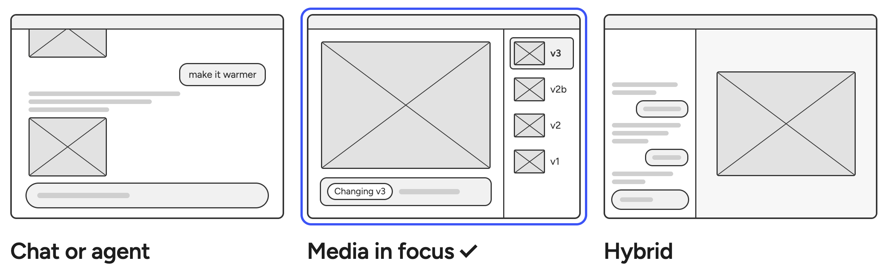

# 0001 · Media in focus, not a chat

> What should the core experience feel like?

| Option | Good | Not so good |
|---|---|---|
| Chat or agent | Assistant can do more than just images| Each image scrolls away. Going back or branching gets lost in the thread. |
| **Media in focus** ✓ | The image is the biggest thing on screen, and every action says what it changes. | Less flexible. |
| Hybrid: a chat beside the image | The image stays large. | Two places to look. |

**Why:** The image is the core of the work. With it in the middle and its versions beside it, you always know
which version you're changing. Want to make a focused tool that makes images, agentic/conversational features distracts from the core value. 

**What it costs:** No back-and-forth help with prompts/ideas. Worth checking if this is something users will miss. 
