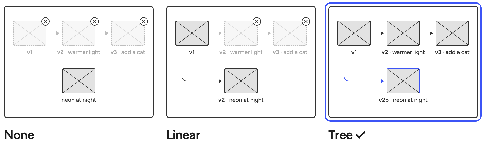

# 0002 · Versions form a tree

> When you go back and change an earlier image, what happens to everything after it?

| Option | Good | Not so good |
|---|---|---|
| None: each change replaces the image | Simple. | No history, and better variants might get lost. |
| Linear: an undo history | Familiar. | Changing an earlier image throws away everything after it. |
| **Tree** ✓ | Nothing is lost. Going back starts a branch. | More to store, and more complexity in the versioning. |

**Why:** Trying something should feel free. If going back can destroy work, users will stop going back.
With a tree, everything is preserved, and we get a proper trail for what lead to each image. 

**What it costs:** Storage needs are highe. More complex system to learn. 
