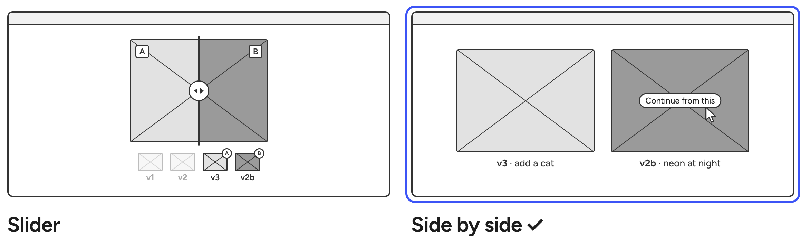

# 0003 · Compare side by side

> How can the user clearly see what's changed between versions?

| Option | Good | Not so good |
|---|---|---|
| Slider: wipe between two | Good for showing smaller differences. | Only two at a time, and a bit pointless when comparing totally different images. |
| **Side by side** ✓ | Can compare more than two. | Small changes are harder to spot. |

**Why:** Decided that image comparison should be simple and clean. No need for smart comparison tools, just being able to bring them up side by side is plenty for now. Can also move between versions with arrow keys in Studio view, which handles the cases where side by side falls short. 

**What it costs:** Harder to spot small differences (for instance lighting errors), so user will need to rely on arrow key switching for this. 
