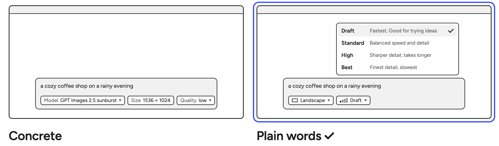

# 0004 · Abstracted controls

> Should we surface the technical details or only our own abstractions?

| Option | Good | Not so good |
|---|---|---|
| Concrete| Full control for experts. | Jargon for everyone else, and tied to one provider. |
| **Abstracted** ✓ | Nothing to learn. Survives vendor changes. | Experts might miss full control |

**Why:** I want to make it as simple to use as possible for anyone, without needing to know the underlying tech. 

**What it costs:** Loss of granular control for expert users. 

**Later:** Let people choose. Onboarding could ask whether you want granular control, and a
setting could switch it at any time.
