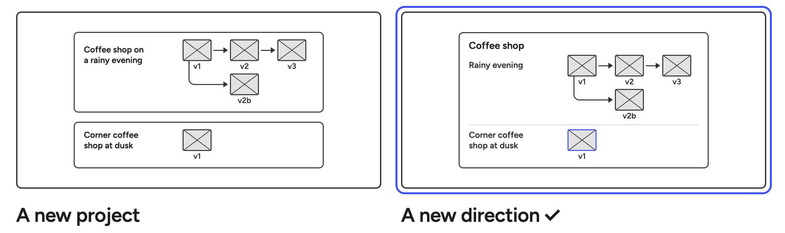

# 0005 · Directions, not smaller projects

> Where does a completely different idea go?

| Option | Good | Not so good |
|---|---|---|
| A new project | Nothing new to learn. | The earlier attempts end up somewhere else. |
| **A new direction in the same project** ✓ | Change course and keep what you tried in view. | One more idea to learn. |

**Why:** In my eyes Projects represent an overall objective. To reach that objective, we may work on many directions for a solution. Capturing these directions in different buckets within a project, allows for better organisation and comparison. 

**What it costs:** Quick single-image projects may bloat the projects list. 
