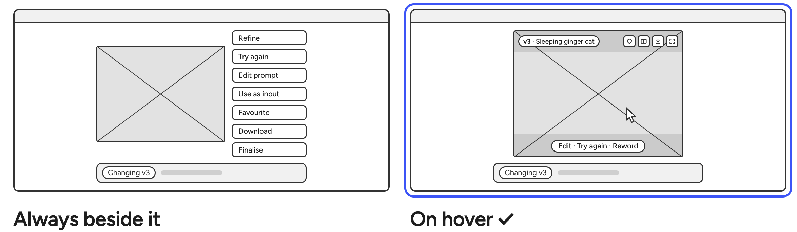

# 0006 · Image controls on hover

> Should the image's actions always be visible, or appear when you need them?

| Option | Good | Not so good |
|---|---|---|
| Always beside the image | Easy to find. Works on touch. | Takes room from the image, and competes with it. |
| **On the image, on hover** ✓ | The image gets the space. The actions sit on what they act on. | Hidden until you hover, and touch screens can't hover. |

**Why:** Removing visual bloat is crusial in a visual tool like this. We surface the controls when they are needed. Shortcuts should always work, also when controls are not visible. 

**What it costs:** Discovering the features is harder the first time you try it. Also, this solution is not the best for touch-screens, so might need to rethink it, if users regularly use Ipads. 
